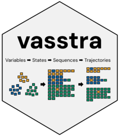
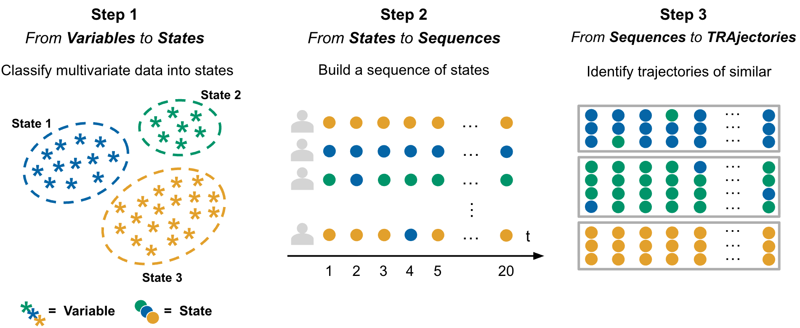
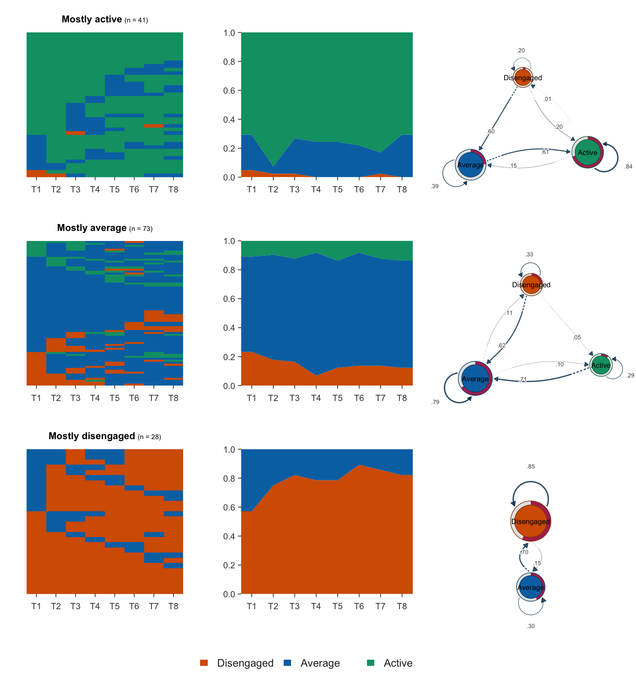

<!-- README.md is generated from README.Rmd. Please edit that file -->

# VaSSTra 

`VaSSTra` turns longitudinal multivariate data into interpretable
states, sequences, and trajectory groups. The whole analysis is one
call, every part of it is also a simple explicit step, and every
automated decision is reported and recorded.

## The method

**VaSSTra** utilizes a combination of person-based methods (to capture
the latent states) along with life events methods to model the
longitudinal process. In doing so, **VaSSTra** effectively leverages the
benefits of both families of methods in mapping the patterns of
longitudinal temporal dynamics. The method has three main steps that can
be summarized as (1) identifying latent **S**tates from **Va**riables,
(2) modeling states as **S**equences, and (3) identifying
**Tra**jectories within sequences. The three steps are depicted in the
figure and described in detail below:

<figure>

<figcaption aria-hidden="true">The VaSSTra method: variables are
clustered into states, each subject’s states over time form a sequence,
and similar sequences are grouped into trajectories.</figcaption>
</figure>

## Package features

- **State clustering:** LPA, k-means, PAM, CLARA, FANNY, DIANA, and
  hierarchical linkages.
- **Trajectory clustering:** nine sequence distances with PAM or
  hierarchical linkages.
- **Standardization:** within time, within subject, global, or none.
- **Evaluation metrics:** silhouette, BIC and the full
  information-criterion family, entropy, and posterior probabilities.
- **Plots:** state, sequence, and trajectory views, the combined grid,
  evaluation panels, and flow and transition networks via `cograph`.
- **Tidy outputs:** per subject, observation, state profile, or
  trajectory, plus transition tables and centralities.
- **Automation** with every decision reported, and an interactive Shiny
  app.

## Installation

``` r
# install.packages("pak")
pak::pak("sonsoleslp/vasstra")
```

## One call

`vasstra(data)` needs nothing else: it detects the subject, time, and
indicator roles from the attached metadata and selects the state and
trajectory counts automatically, reporting each decision.

``` r
library(VaSSTra)
data("engagement", package = "VaSSTra")

vasstra(engagement)
#> Selected n_states = 5 (lpa, bic = 19008.964); see `diagnostics$selection`.
#> Selected n_trajectories = 3 (hamming + pam, silhouette = 0.222); see `diagnostics$selection`.
#> VaSSTra Analysis
#>   142 subjects | 8 times | 5 states | 3 trajectories
#>   hamming + pam | silhouette 0.222
```

States are estimated by latent profile analysis by default;
`state_method` switches to k-means, PAM, or hierarchical clustering.
Automatic selection compares 2 through 6 candidates. Here it settles on
five states. Naming the states fixes the count instead, and naming any
other decision takes it over. This is the fit the figure below is drawn
from:

``` r
fit <- vasstra(
  engagement,
  state_labels  = c("Disengaged", "Average", "Active"),
  state_colors  = c(Disengaged = "#D55E00", Average = "#0072B2", Active = "#009E73"),
  dissimilarity = "lcs",
  cluster_method = "ward.D2",
  positive_states = "Active",
  negative_states = "Disengaged",
  trajectory_labels = c("Mostly active", "Mostly average", "Mostly disengaged")
)
```

## What you get

One fit describes each trajectory three ways at once: the transition
network it follows, the sequences it groups, and how its state
composition unfolds over time, all on a shared palette and state order.

``` r
plot(fit, type = c( "index", "distribution", "transition"))
```



## Interactive app

`launch_app()` opens a Shiny application (requires the suggested `shiny`
and `DT` packages) that runs the whole workflow interactively: load
data, map roles, fit, inspect every tab, rename groups, and export the
tidy tables.

``` r
VaSSTra::launch_app()
```

## Dependencies

`mclust` powers the default LPA state estimation, base R provides
k-means and hierarchical clustering, `cluster` provides PAM, and
`Nestimate` provides sequence distances, trajectory clustering, and all
sequence plots. `cograph` is suggested, not required, and renders the
flow and transition plots.

Method overview: [VaSSTra
chapter](https://lamethods.org/book1/chapters/ch11-vasstra/ch11-vasstra.html).
