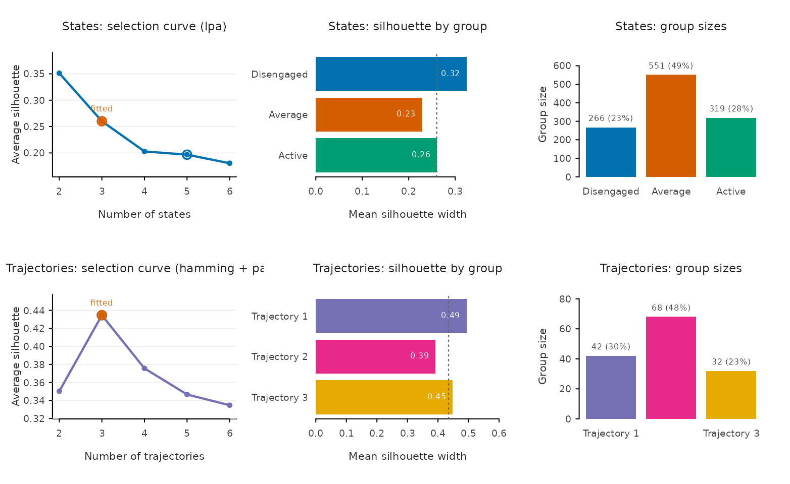
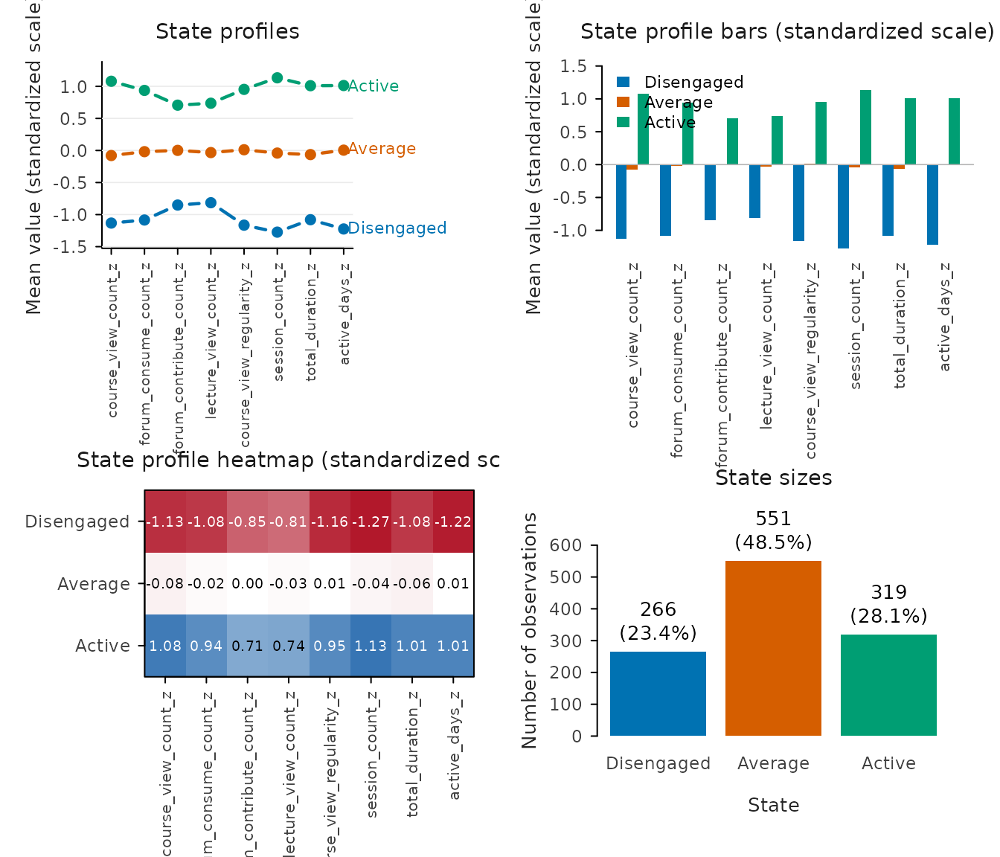
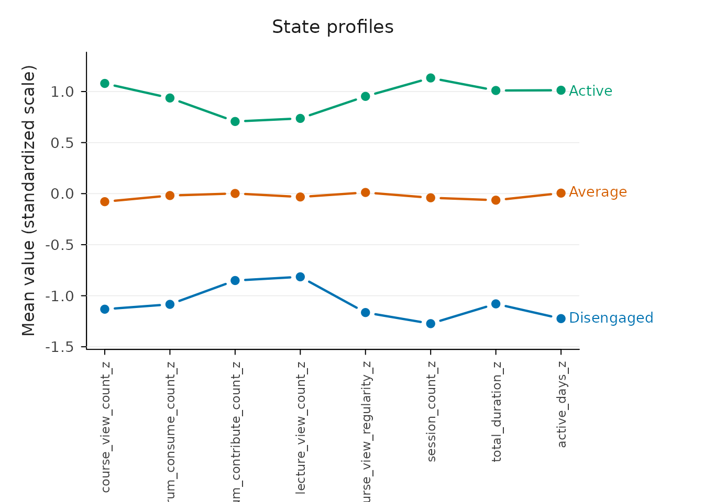
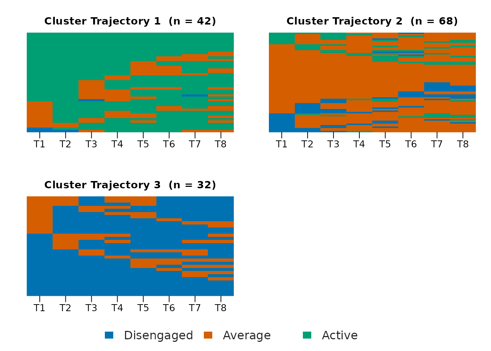
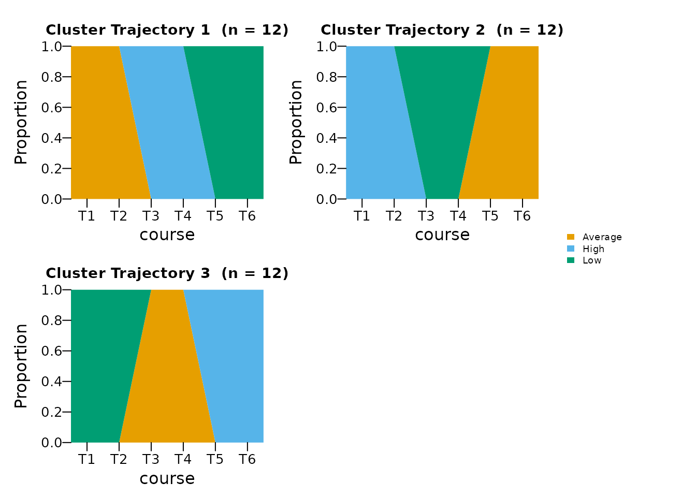
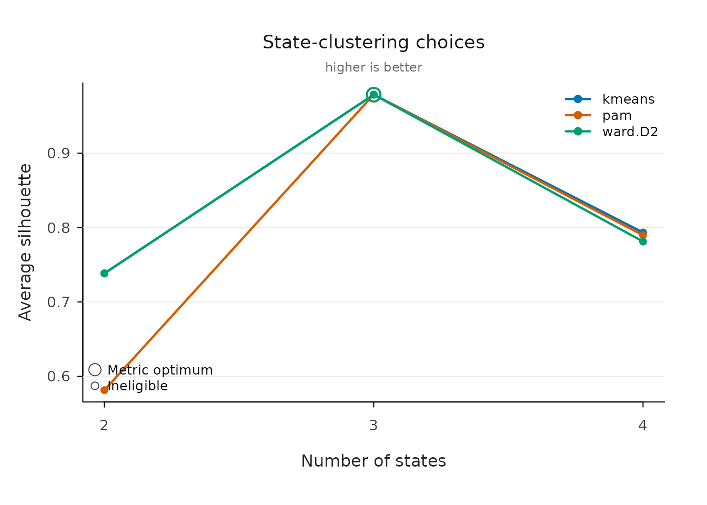
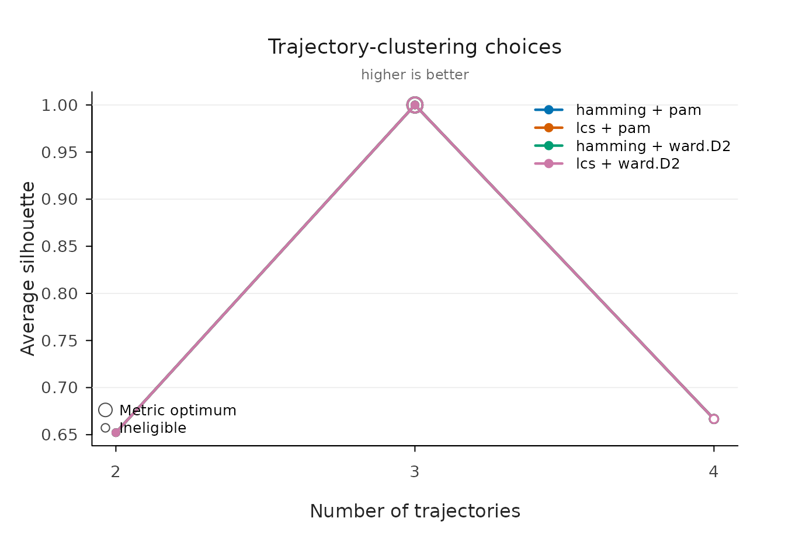

# Getting started with VaSSTra

VaSSTra turns repeated multivariate measurements into states, state
sequences, and groups of similar trajectories. The whole analysis is one
call, and every part of it can also be run as an explicit step.

This guide uses the built-in `engagement` data: 142 students measured on
eight indicators at eight course positions, from the [VaSSTra
chapter](https://lamethods.org/book1/chapters/ch11-vasstra/ch11-vasstra.html)
of *Learning Analytics Methods and Tutorials*. It ships analysis-ready
with attached role metadata, so no column plumbing is needed.

``` r

library(VaSSTra)
data("engagement", package = "VaSSTra")
```

## Using your own data

[`vasstra()`](https://sonsoles.me/vasstra/reference/vasstra.md) needs
three roles: the **subject** (`id`), the **time** column (`time`), and
the numeric **indicators** (`variables`). The `engagement` data carry
these as attached metadata, so they are found automatically; your own
data frame will not, so you name the subject and time columns. On
`engagement` this is redundant, but it is exactly the call you would
write for data with different column names:

``` r

fit <- vasstra(
  engagement,
  id   = "user_id",            # one row per subject and time point
  time = "sequence_position",  # the ordering column
  state_labels = c("Disengaged", "Average", "Active")
)
#> Using n_states = 3 to match the supplied labels.
#> Selected n_trajectories = 3 (hamming + pam, silhouette = 0.435); see `diagnostics$selection`.
```

`variables` was left out on purpose: the numeric columns that are not
the `id` or `time` become the indicators (columns ending in `"_z"` are
preferred when present, so a mix of raw and standardized columns picks
the standardized set, as it does here). Name them to fit a specific
subset. Here we keep only the three activity-volume indicators:

``` r

fit <- vasstra(
  engagement,
  id        = "user_id",
  time      = "sequence_position",
  variables = c("session_count_z", "total_duration_z", "active_days_z"),
  state_labels = c("Disengaged", "Average", "Active")
)
#> Using n_states = 3 to match the supplied labels.
#> Selected n_trajectories = 3 (hamming + pam, silhouette = 0.422); see `diagnostics$selection`.
```

Columns that follow a common convention are detected even without `id`
and `time` (`id`: `id`, `student`, `subject`, `actor`, …; `time`:
`time`, `week`, `wave`, `session`, …); anything else raises a clear
error asking you to supply that role. Two more notes: pass `time_levels`
when `time` is a character or unordered factor so the chronology is
explicit, and use `state` instead of `variables` when the data already
carry a categorical state column (the analysis then starts at
[`step2_sequences()`](https://sonsoles.me/vasstra/reference/step2_sequences.md)).

## One call

[`vasstra()`](https://sonsoles.me/vasstra/reference/vasstra.md) detects
the subject, time, and indicator roles from the attached role metadata
(or common column names), compares two through six states and
trajectories, and fits the recommended counts. Every automated decision
is reported as it is made and recorded inside the fit. Here three state
labels fix three states; omit them and the state count is selected too.

``` r

fit <- vasstra(engagement, state_labels = c("Disengaged", "Average", "Active"))
#> Using n_states = 3 to match the supplied labels.
#> Selected n_trajectories = 3 (hamming + pam, silhouette = 0.435); see `diagnostics$selection`.
fit
#> VaSSTra Analysis
#>   142 subjects | 8 times | 3 states | 3 trajectories
#>   hamming + pam | silhouette 0.435
```

Name any decision to take it over; automation only fills what you omit.
Labels are the shortest way to fix a count (three labels mean three
states), and a candidate vector such as `n_states = 2:4` compares
exactly those counts and fits the recommended one. Two more arguments
control how states display everywhere: `state_order` fixes the order
states appear in across every plot, and `state_colors` sets a state
palette that is stored on the fit and reused by every plot.

``` r

fit <- vasstra(
  engagement,
  state_labels = c("Disengaged", "Average", "Active"),
  trajectory_labels = c("Mostly active", "Mostly average", "Mostly disengaged"),
  dissimilarity = "lcs",
  cluster_method = "ward.D2",
  positive_states = "Active",
  negative_states = "Disengaged"
)
```

## Evaluate the clustering

[`evaluate()`](https://sonsoles.me/vasstra/reference/evaluate.md)
compares the fitted numbers of states and trajectories against the
alternative counts and reports per-cluster quality. Printing shows both
tables; plotting draws the selection curve, per-cluster silhouette
widths, and group sizes.

``` r

evaluation <- evaluate(fit)
```

``` r

plot(evaluation)
```



The same verb works on a single step, with any candidate range:

``` r

state_evaluation <- evaluate(fit$states, n_states = 2:5)
summary(state_evaluation)
#>        state   n proportion silhouette
#> 1 Disengaged 266       0.23       0.32
#> 2    Average 551       0.49       0.23
#> 3     Active 319       0.28       0.26
```

## Tidy fit indices

[`fit_indices()`](https://sonsoles.me/vasstra/reference/fit_indices.md)
reports the fit statistics of the selected clustering as one tidy row,
or one row per compared candidate with `compare = TRUE`. LPA models
report the complete information-criterion family together with entropy
and the extreme average posterior class probabilities; hard-clustering
methods report their own objectives instead, and columns that do not
apply are dropped.

``` r

fit_indices(fit)
#> VaSSTra fit indices: states (lpa)
#>  n_states method lpa_model log_likelihood n_parameters   aic   bic sabic  caic
#>         3    lpa       EEI          -9940           34 19949 20120 20012 20154
#>    awe   clc   kic   icl entropy prob_min prob_max silhouette min_size max_size
#>  20461 20145 19986 20384    0.89     0.94     0.96       0.26      266      551
#>  size_ratio
#>         2.1
fit_indices(fit, compare = TRUE)
#> VaSSTra fit indices: states (lpa)
#>  n_states method lpa_model log_likelihood n_parameters   aic   bic sabic  caic
#>         2    lpa       EEI         -10752           25 21553 21679 21600 21704
#>         3    lpa       EEI          -9940           34 19949 20120 20012 20154
#>         4    lpa       EEI          -9530           43 19146 19362 19226 19405
#>         5    lpa       EEI          -9322           52 18747 19009 18844 19061
#>         6    lpa       EEI          -9086           61 18294 18601 18407 18662
#>    awe   clc   kic   icl entropy prob_min prob_max silhouette min_size max_size
#>  21930 21655 21581 21831    0.90     0.97     0.97       0.35      509      627
#>  20461 20145 19986 20384    0.89     0.94     0.96       0.26      266      551
#>  19794 19398 19192 19700    0.89     0.93     0.97       0.20      152      414
#>  19531 19114 18802 19480    0.87     0.87     0.96       0.20      155      367
#>  19213 18633 18358 19062    0.89     0.88     0.97       0.18       33      350
#>  size_ratio eligible  best fitted
#>         1.2     TRUE FALSE  FALSE
#>         2.1     TRUE FALSE   TRUE
#>         2.7     TRUE FALSE  FALSE
#>         2.4     TRUE  TRUE  FALSE
#>        10.6    FALSE FALSE  FALSE
fit_indices(fit, step = "trajectories", compare = TRUE)
#> VaSSTra fit indices: trajectories (hamming + pam)
#>  n_trajectories dissimilarity method silhouette mean_within_distance min_size
#>               2       hamming    pam       0.35                  4.0       47
#>               3       hamming    pam       0.43                  3.0       32
#>               4       hamming    pam       0.38                  2.8       15
#>               5       hamming    pam       0.35                  2.7       15
#>               6       hamming    pam       0.34                  2.5       12
#>  max_size size_ratio eligible  best fitted
#>        95        2.0     TRUE FALSE  FALSE
#>        68        2.1     TRUE  TRUE   TRUE
#>        59        3.9     TRUE FALSE  FALSE
#>        54        3.6     TRUE FALSE  FALSE
#>        40        3.3     TRUE FALSE  FALSE
```

## Name groups after inspecting them

[`set_labels()`](https://sonsoles.me/vasstra/reference/set_labels.md)
renames fitted states or trajectories in place (nothing is refitted, no
value changes), and the new names flow through every table, sequence,
and plot. Rename everything with a full vector, or only some groups by
name.

``` r

fit <- set_labels(
  fit,
  trajectories = c("Mostly active", "Mostly average", "Mostly disengaged")
)
summary(fit)
#>          trajectory  n proportion mean_within_distance n_observed unique_states
#> 1     Mostly active 42       0.30                  2.9          8           1.9
#> 2    Mostly average 68       0.48                  3.1          8           2.0
#> 3 Mostly disengaged 32       0.23                  3.0          8           1.8
#>   transitions entropy complexity volatility integrative_potential
#> 1         1.9    0.42       0.33       0.45                   NaN
#> 2         2.2    0.46       0.37       0.49                   NaN
#> 3         2.1    0.43       0.35       0.45                   NaN
#>   negative_exposure
#> 1               NaN
#> 2               NaN
#> 3               NaN
```

## The same analysis in four explicit steps

Each step accepts the result of the previous step and also runs alone
with the same automated defaults. Use the steps when intermediate
results are needed, or when states come from another method.

``` r

states <- step1_states(engagement,
                       labels = c("Disengaged", "Average", "Active"))
#> Using n_states = 3 to match the supplied labels.
sequences <- step2_sequences(states)
trajectories <- step3_trajectories(sequences, n_trajectories = 3)
description <- step4_describe(
  trajectories,
  positive_states = "Active",
  negative_states = "Disengaged"
)
summary(description)
#>     trajectory  n proportion mean_within_distance n_observed unique_states
#> 1 Trajectory 1 42       0.30                  2.9          8           1.9
#> 2 Trajectory 2 68       0.48                  3.1          8           2.0
#> 3 Trajectory 3 32       0.23                  3.0          8           1.8
#>   transitions entropy complexity volatility integrative_potential
#> 1         1.9    0.42       0.33       0.45                  0.76
#> 2         2.2    0.46       0.37       0.49                  0.12
#> 3         2.1    0.43       0.35       0.45                  0.00
#>   negative_exposure
#> 1            0.0093
#> 2            0.1185
#> 3            0.7665
```

Existing states from LPA, LCA, or any other source enter at step 2: pass
a data frame whose state column is detected automatically (or named with
the `state` argument).

## State plots

State results support profile, bar, heatmap, and size plots without
adding a plotting dependency, plus a combined overview.

``` r

plot(states, type = "all")
```



``` r

plot(states, type = "profile")
```



## Sequence and trajectory plots

Every plot containing state sequences is rendered by Nestimate:

``` r

plot(trajectories, type = "index")
```



``` r

plot(trajectories, type = "distribution")
```



## Compare candidates in full detail

When automation should be replaced by an explicit comparison,
[`state_choices()`](https://sonsoles.me/vasstra/reference/state_choices.md)
and
[`trajectory_choices()`](https://sonsoles.me/vasstra/reference/trajectory_choices.md)
fit a grid across methods and counts and return one tidy row per
candidate. Nothing is selected silently; pass the inspected
`candidate_id` to fit.

``` r

state_options <- state_choices(
  engagement,
  n_states = 2:4,
  method = c("kmeans", "pam", "ward.D2")
)
state_options
#> VaSSTra state choices
#>   9 candidates | 9 successful | 3 recommended
#>  candidate_id n_states  method lpa_model recommendation_criterion silhouette
#>             1        2  kmeans      <NA>               silhouette       0.35
#>             4        2     pam      <NA>               silhouette       0.35
#>             7        2 ward.D2      <NA>               silhouette       0.33
#>  bic min_size eligible
#>   NA      519     TRUE
#>   NA      543     TRUE
#>   NA      483     TRUE
plot(state_options, metric = "silhouette")
```



``` r

chosen_states <- fit_state_choice(
  state_options,
  n_states = 3,
  method = "kmeans",
  labels = c("Disengaged", "Average", "Active")
)
```

`fit_state_choice(state_options)` with no selection fits the recommended
candidate; `candidate_id` remains available for exact row selection.

Average silhouette is the common diagnostic across all methods; larger
values indicate better-separated groups. Recommendations identify the
best eligible candidate separately for each method rather than declaring
one algorithm universally best. LPA candidates are recommended by
conventional BIC, with AIC, silhouette, or native mclust ICL available
through `lpa_criterion`.

``` r

trajectory_options <- trajectory_choices(
  step2_sequences(chosen_states),
  n_trajectories = 2:4,
  dissimilarity = c("hamming", "lcs"),
  method = c("pam", "ward.D2")
)
trajectory_options
#> VaSSTra trajectory choices (Nestimate)
#>   12 candidates | 4 recommended distance-method solutions
#>  candidate_id n_trajectories dissimilarity  method silhouette min_size eligible
#>             2              3       hamming     pam       0.44       35     TRUE
#>             5              3           lcs     pam       0.53       27     TRUE
#>             8              3       hamming ward.D2       0.39       33     TRUE
#>            11              3           lcs ward.D2       0.47       40     TRUE
plot(trajectory_options, metric = "silhouette")
```



Recommendations are made within each distance-method pair because mean
within-trajectory distances are only comparable within one
dissimilarity.

States default to `mclust` latent profiles (`"EEI"`, tidyLPA model 1);
base R supplies k-means and hierarchical clustering, `cluster` supplies
PAM, CLARA, FANNY, and DIANA, and `Nestimate` supplies sequence
distances, trajectory clustering, and plots. No `TraMineR` plotting path
or dependency is required. See
[`vignette("clustering-algorithms")`](https://sonsoles.me/vasstra/articles/clustering-algorithms.md)
for the full list of state and trajectory methods.
